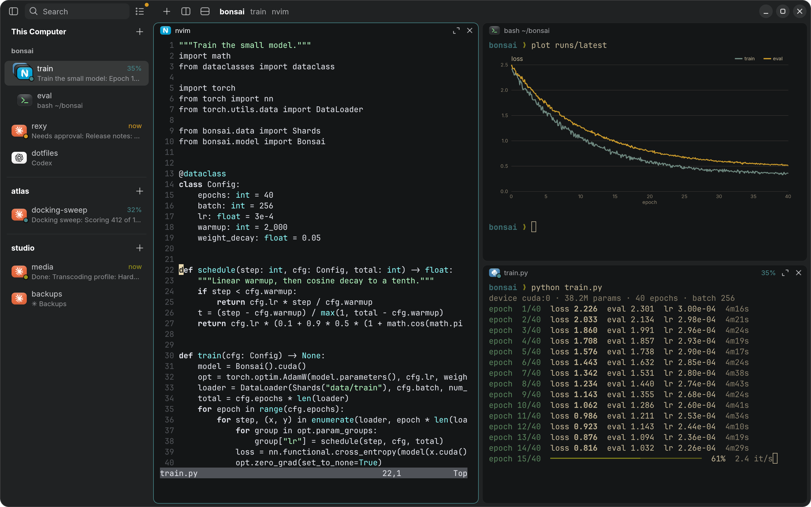

# Rex Lite

A small, fast, native Linux client for [Rex](https://www.superlogical.com/rex), built with Rust, egui and libghostty.



Every Rex server you use, with its sessions and tabs, in one window: a sidebar that tells you what each agent is doing, split panes, and a Ghostty terminal in each of them. Closing the window leaves your sessions running, and connecting never starts or installs a server.

Rex Lite is an unofficial client and is not affiliated with Superlogical. It is early software for Linux, on Wayland and X11.

## Features

- **Every server in one sidebar.** Your home server and every host it knows of, with their sessions and tabs, over a Unix socket, SSH or WebSocket. Fold away what you are not using, or put the tabs along the top instead.
- **See what your agents are doing.** Each tab shows the icons of its programs, a status dot and a line in words: *Working*, *Needs approval*, *Question*, *Done*, *Error*, with progress or how long it has been that way. An activity view lists every pane on every server under **Needs you**, **Done**, **Working** and **Idle**.
- **Notifications that take you there.** What a tab reports while you are not looking at it becomes a desktop notification, and clicking it shows the pane. Any tab can be muted.
- **Splits.** Split a pane in any direction, resize with the mouse or the keys, balance the tab, or zoom one pane to fill it. Move a pane within its tab, into another tab of its session, or out to a tab of its own.
- **A real terminal.** libghostty does the emulation, so programs behave as they do in Ghostty: Kitty graphics, hyperlinks, synchronized output, shell prompt marks, clipboard copies, IME input.
- **Your Ghostty colours.** Terminals take the theme from Ghostty's configuration, if it is on the machine, and the window is tinted to match.
- **Selection, search and scrollback.** Select by character, word, line or block, find text through a pane's whole history, and jump between shell prompts.
- **A command palette.** **Ctrl Shift K** finds a session or tab on any server, and **Ctrl Shift P** lists every action with its keys.
- **Rex's own keymap.** Keys come from your home server's `init.lua`, with sequences and modes, and the window can be driven with `rex -C`.
- **Quick to switch.** The last sixteen tabs you looked at on each server stay live in the background, so going back to one is instant. A lost connection is retried by itself.

## Install

Rex Lite builds from source. You need:

- Rust 1.100 (pinned in `rust-toolchain.toml`)
- Zig 0.17.x, to build libghostty (pinned in `mise.toml`)
- `git`, which fetches Ghostty's source on the first build

With [mise](https://mise.jdx.dev/):

```sh
mise install
./scripts/icons    # optional: program icons, see below
mise exec -- cargo build --release --locked
```

Without mise, put Zig 0.17.x on `PATH` or point `ZIG` at it, and run `cargo build --release --locked`. The finished binary does not need Zig.

Program icons are Superlogical's and are not kept in this repository. `./scripts/icons` fetches them before a build; without them every tab shows a prompt icon. See [assets/icons/NOTICE.md](assets/icons/NOTICE.md) before passing on a build that includes them.

To install the binary with a desktop entry and icon:

```sh
install -Dm755 target/release/rex-lite ~/.local/bin/rex-lite
install -Dm644 assets/dev.rex-lite.client.desktop -t ~/.local/share/applications
install -Dm644 assets/dev.rex-lite.client.svg -t ~/.local/share/icons/hicolor/scalable/apps
gtk-update-icon-cache -f -t ~/.local/share/icons/hicolor
```

## Usage

Start your Rex server, then run:

```sh
rex-lite
```

With no arguments the window opens on your Rex home: the server named by `REX_HOME`, or the one chosen with `rex home set`, or else this machine's own server at `$XDG_RUNTIME_DIR/rex/server.sock`. To open another:

```sh
rex-lite --server unix:///path/to/server.sock
rex-lite --server ssh://studio
rex-lite --server studio.example.ts.net
```

`--probe` checks that a server can be reached and its terminals decoded, without opening a window or sending any input.

### Other servers

The sidebar lists the server you opened, then every host that server knows of. Hosts are Rex's own list, shared with the `rex` CLI and its other clients:

```sh
rex hosts add studio ssh://studio
```

| Address | How it is reached |
|---|---|
| `unix:///path` | The socket directly. |
| `ssh://[user@]host[:port]` | As the Rex CLI does it: `ssh` asks that machine where its server listens and forwards the socket. Needs `rex` there and an `ssh` that connects without prompting. |
| `ws://`, `wss://` | WebSocket, with or without TLS. |
| A bare host name | HTTPS on port 443, then HTTPS on 7297, then HTTP on 7297, as Rex tries it. |

A server that cannot be reached is retried every fifteen seconds, so the window can be opened before the server is up. One reached through `ssh` is tried three times and then waits for the retry button beside its name, so that a refused login is not repeated until the machine blocks you.

## Keys

These are the defaults. They are Rex's keys: `rex.bind` and `rex.unbind` in your home server's `init.lua` change them and add sequences such as `ctrl+b>c`, modes, and actions of your own. `rex config reload` applies a change at once.

| Keys | Action |
|---|---|
| **Ctrl Shift K** | Find a session or tab |
| **Ctrl Shift P** | Command palette |
| **Ctrl Shift B** | Sidebar, or tabs along the top |
| **Ctrl Shift N** | New session |
| **Ctrl Shift T** | New tab |
| **Ctrl Tab**, **Ctrl Shift Tab** | Next and previous tab (also **Ctrl PageDown**, **Ctrl PageUp**) |
| **Ctrl Shift PageUp**, **Ctrl Shift PageDown** | Move the tab backward or forward |
| **Ctrl Shift D**, **Ctrl Alt D** | Split the pane right or down |
| **Ctrl Alt** + arrow | Focus the pane on that side |
| **Ctrl Alt Shift** + arrow | Move the pane's border that way |
| **Ctrl Alt =** | Give every pane equal room |
| **Ctrl Shift Enter** | Zoom the pane |
| **Ctrl Shift W** | Close the pane |
| **Ctrl Shift C**, **Ctrl Shift V** | Copy and paste |
| **Ctrl Shift F** | Find in the pane (**Enter** and **Shift Enter** step through matches) |
| **Shift PageUp**, **Shift PageDown** | Scroll a screen |
| **Shift Home**, **Shift End** | Scroll to the top or the bottom |
| **Ctrl Shift Up**, **Ctrl Shift Down** | Previous and next shell prompt |
| **Ctrl +**, **Ctrl -**, **Ctrl 0** | Font size |

After the first keys of a sequence, or inside a mode, the keys that can come next are listed at the foot of the window.

With the mouse:

- Drag to select; double-click a word, triple-click a line. **Ctrl Alt** and a drag selects a block. A selection is also the desktop's primary selection, which a middle click pastes.
- **Shift** overrides a program's mouse capture.
- Hold **Ctrl** over a link and click to open it.
- Drag the line between two panes to resize them; double-click it to even them out.
- Drag a pane's header onto a tab to move the pane there, or onto its session's name to give it a tab of its own, as **Move Pane to New Tab** in the pane's menu does. A tab with one pane joins another tab when dropped on its middle.
- Click a server's heading to fold its sessions away, or a session's heading, anywhere but its name, to fold its tabs.
- Right-click a session, tab or pane for its menu. Double-click a name to rename it, and drag a session or tab to reorder it.

## Good to know

**Your tab stays put.** The tab on show is the window's own choice. It does not follow what another client or the `rex` CLI has the server show, though a key you bind in `init.lua` to change tabs does move it.

**Panes are sized by their owner.** The window takes the panes of a tab when you show it, so they fit this window. Another client that shows the tab later takes them in turn, and they are this window's again when you click or type in one.

**Closing asks only when it matters.** A pane or tab with nothing running but shells at their prompts closes at once. Anything busier, and any session with several tabs, turns its `×` into **Close?** and waits for a second click.

**Remote control is off by default.** `rex -C <client> do pane.zoom` and the like work only after you choose **Allow Remote Control** in the palette. With it on, any client of the server can type into a pane, paste your clipboard or close things. Asking the window to show a session is always allowed.

**Programs cannot reach your machine.** A program can copy to the clipboard but never read it. `file` links are never opened, since the terminal may be showing another machine. Pictures are accepted only as pixels sent in the escape itself: the Kitty protocol's file and shared-memory transfers would be read on this machine, and are refused.

**State** is kept in `rex-lite/state.json` under `$XDG_STATE_HOME` or `~/.local/state`: window size, font size, sidebar layout, what is folded or muted, whether remote control is allowed, and the tab last shown on each server.

**Notifications** need a notification service on the session's D-Bus, as GNOME, KDE and most desktops provide. Without one, nothing is sent and nothing else changes.

## Not yet

- Adding or editing hosts from the window, or installing Rex on another machine
- Floating panes
- Moving a pane or a tab to another session, which Rex itself has no way to do
- Animated pictures
- Platforms other than Linux

Rex Lite speaks revision 13 of Rex's control API. A server that is older, or too new, is refused with a message that says what each side speaks. Keyboard layouts and IMEs need broader testing.

## How it works

- Each server has one network runtime for control and terminal traffic. Each live pane has its own Ghostty worker thread; parsing never runs on the UI thread.
- Terminal bytes travel through bounded queues with backpressure and are never dropped. Redraw requests coalesce, and the UI reads the newest immutable frame.
- Rows that have not changed are shared between frames. The renderer caches shaped text by row and never builds a widget per cell.
- Workers sleep when idle. A pane that is out of sight keeps reading its output but draws nothing. Only the last sixteen tabs shown on a server keep their streams; any other is restored from a fresh snapshot when shown.
- A snapshot starts with the screen, which is drawn as soon as it arrives, and the history follows. Each pane keeps up to 32 MiB of scrollback, held compressed until it is scrolled to, and up to 128 MiB of pictures per screen.
- Input that fails to send is reported and never replayed after a reconnection.

## Development

`scripts/dev` runs `cargo` with the local Zig toolchain found for you:

```sh
./scripts/dev run --release
./scripts/dev test --locked
./scripts/dev clippy --locked --all-targets -- -D warnings
./scripts/dev fmt --all -- --check
```

All test code lives under `tests/`. Unit modules in `tests/unit/` are compiled into the crate, so they can test private details without making them public.

The end-to-end check starts its own disposable Rex server, Xvfb display and D-Bus session, drives the real window, and cleans up after itself:

```sh
./scripts/dev build --locked
python3 tests/smoke.py                                  # the debug build
python3 tests/smoke.py --binary target/release/rex-lite
```

It needs `rex`, `Xvfb`, `dbus-run-session`, `xclip`, ImageMagick's `import` and the X11/XTest libraries. It runs on X11; Wayland is checked by hand.

`tests/live.rs` exercises the backend alone against a server you name. It sends input and creates tabs and panes, so point it only at a disposable server, never at your own sessions:

```sh
REX_LITE_TEST_SERVER="unix://$PWD/work/smoke/server.sock" \
  ./scripts/dev test --test live -- --ignored --nocapture --test-threads=1
```

## Credits

Rex is made by [Superlogical](https://www.superlogical.com/rex). Terminal emulation is [Ghostty](https://ghostty.org)'s, through [libghostty-rs](https://github.com/Uzaaft/libghostty-rs), and the interface is [egui](https://github.com/emilk/egui). Parts of the terminal metadata handling are adapted from [rex-rune](https://github.com/shuv1337/rex-rune). The fonts are Inter and JetBrains Mono.

See [THIRD_PARTY.md](THIRD_PARTY.md) for licences and attribution.
